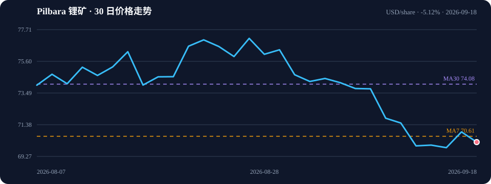

# Pilbara 锂矿 每日简报

> 生成时间：2026-09-18 14:42 UTC
>
> **行情：▼ 下跌** ｜ 新闻：2 条 ｜ 资源记录：6 条 ｜ 风险提示：1 条

## 行情速览

| 指标 | 当前值 | 快速判断 |
|---|---:|---|
| 区间涨跌 | **-5.12%** | **▼ 下跌** [4] |
| 最新价格 | 70.22 USD/share | 2026-09-18 [4] |
| 区间范围 | 69.85–77.13 USD/share | 30 个交易日 [4] |
| 均线 | MA7 70.61 / MA30 74.08 | 短线弱于 MA7；中期弱于 MA30 [4] |
| 数据口径 | 上市工具代理价 | 非 LME 金属现货价 [4] |

## 关键新闻

- **2026-09-17｜What Could Pilbara Minerals (ASX:PLS) Mean for Lithium? - Kalkine Media** — What Could Pilbara Minerals (ASX:PLS) Mean for Lithium? Kalkine Media [1]
- **2026-09-16｜What Lithium Prices Mean for ASX Battery Materials Stocks Pilbara Minerals (ASX:PLS), Liontown (ASX:LTR) and Elevra Lithium (ASX:ELV) - Kalkine** — What Lithium Prices Mean for ASX Battery Materials Stocks Pilbara Minerals (ASX:PLS), Liontown (ASX:LTR) and Elevra Lithium (ASX:ELV) Kalkine [2]

## 资源量

| 类别 | 矿种 | 吨位 | 品位 |
|---|---|---:|---:|
| Measured | Li2O | 19.00 Mt | — [3] |
| Indicated | Li2O | 356.00 Mt | — [3] |
| Inferred | Li2O | 70.00 Mt | — [3] |
| Measured | Li2O | 28.64 Mt | — [3] |
| Indicated | Li2O | 38.63 Mt | — [3] |
| Inferred | Li2O | 3.59 Mt | — [3] |

## 分析解读

行情方向为下跌，区间跌幅5.12%（区间69.85–77.13，ma7=70.61、ma30=74.08，30个交易日）[4]。新闻面聚焦锂价对PLS等ASX电池材料股的影响，但未给出具体价格驱动数据[1][2]。资源量方面，2025年报自报合计445.0 Mt[3]；明细逐行求和为515.9 Mt，与自报合计相差+15.9%，超出±5%容差，求和值不可信，应以自报合计为准[3]。最重要风险是资源量口径不一致：明细求和与自报合计偏差达+15.9%，可能源于重复计入或跨项目加总，需以报告自报合计为准[3]。【降级示例数据】中提及的Measured/Indicated/Inferred明细不可采信，不能作为真实资源量陈述[3]。

## 风险与数据质量

- 资源量按类别逐行求和得 515.9 Mt，与报告自报合计 445.0 Mt 相差 +15.9%（超过 ±5% 容差）——求和值不可信（常见于同一份资源量被重复计入，或多张不同项目的资源表被加在了一起），已以报告自报合计为准。

## 来源

1. What Could Pilbara Minerals (ASX:PLS) Mean for Lithium? - Kalkine Media — https://news.google.com/rss/articles/CBMimgFBVV95cUxOYXM3N3pNVE5ONXNYR2szc3htNGEtUktLOTJQOVE5S3JHRW5iRFRJUkQwWW5BUlY1UENGTE5jTXJyZHhObTFPeXRHMXJJZ3NaMmtzU2FhMWVEVVl0dVcxTEZQU2RJTXlxclZqMXVGcUZQdUFqcGJzNDUwNDBHOGF6dGx1d2QyMHhsZVJxN0hZLUU1bEJDQXZmUmZB?oc=5（Google News）
2. What Lithium Prices Mean for ASX Battery Materials Stocks Pilbara Minerals (ASX:PLS), Liontown (ASX:LTR) and Elevra Lithium (ASX:ELV) - Kalkine — https://news.google.com/rss/articles/CBMi7wFBVV95cUxOUTR0WXU2R2FabkhXaE42cENaM3RBaHg5bVBjY01yMmJGQkEyR1F6UFp5eUpzQ3J4T3pBUDFDLTUwVC1VX1dnVWtUSzQ1SGlmamFBaXBLaXdZMEZ5SGpvWkNuNmQ5aUk4dUV0QjJQSUE3NzgwLVFPMVRTWWxZdlVpZXBzLWNUaC1YVWF3Z2ljSTRFc3dnQmMwRExsZ1VhMkJwTnh3NEV3OUdOZmo0SFhGaDNFNXRZZzAxV2c5a2ZOeTI2WExZWDdOMEdhNjBXeGphVTdkWHNVODJrTlUwZUducldJSzZRbEs1RFM1MFZUSQ?oc=5（Google News）
3. Annual Report 2025 资源量报告 — https://www.pls.com/storage/announcements/2025-annual-report-incorporating-appendix-4e-2025-08-25.pdf
4. lithium 价格数据 — Yahoo Finance: LIT (Global X Lithium & Battery Tech ETF) — proxy quote, not an LME lithium spot price
